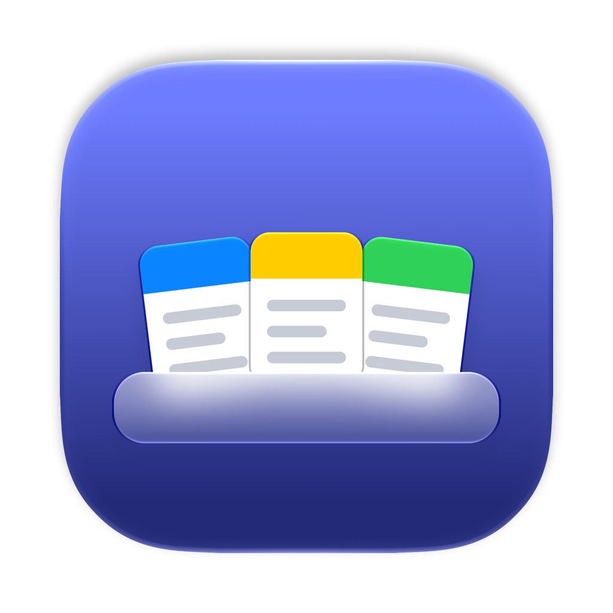
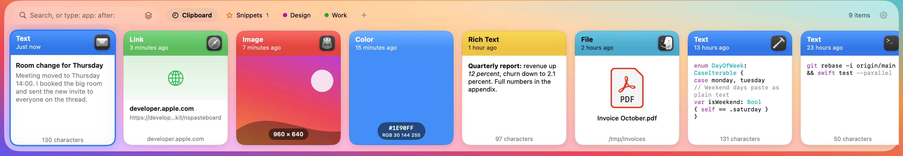
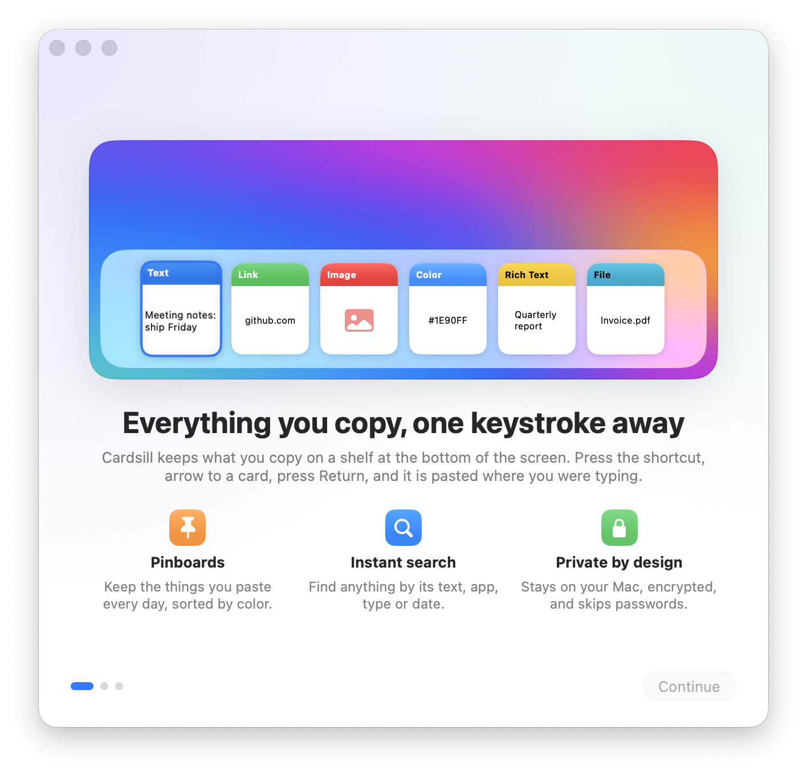
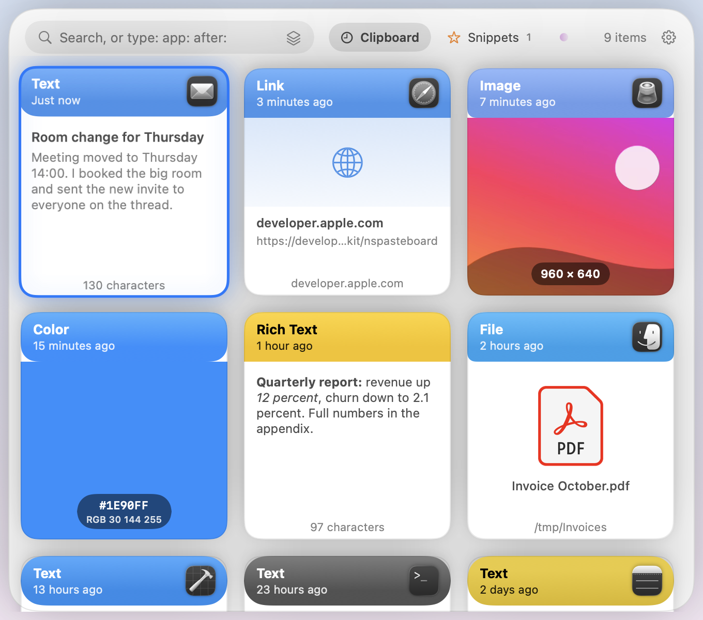
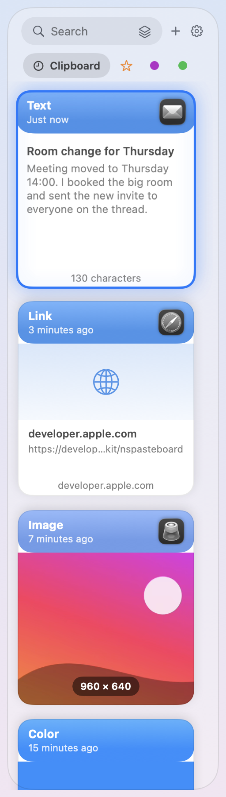
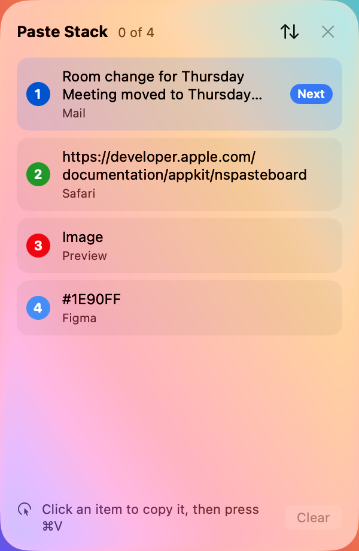
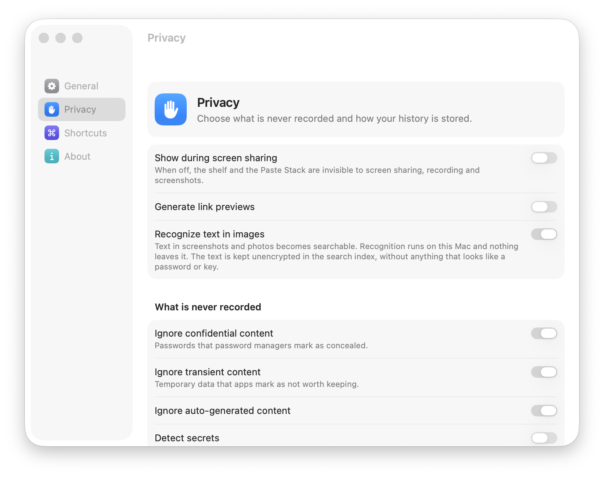

<p align="center"></p>

<h1 align="center">Shelf</h1>

<p align="center"><b>The Paste shelf for macOS: native, open source, no subscription.</b></p>

<p align="center">
  <a href="https://github.com/vertuem/shelf-app/releases/latest">Download</a> ·
  <a href="#install">Install</a> ·
  <a href="#a-quick-tour">Tour</a> ·
  <a href="#keyboard">Keyboard</a> ·
  <a href="#private-by-default">Privacy</a>
</p>

<p align="center">
  
  
  
</p>

<p align="center">
  <picture>
    <source media="(prefers-color-scheme: dark)" srcset="docs/images/shelf-dark.png">
    
  </picture>
</p>

Shelf is a clipboard manager for macOS. Everything you copy lands on a shelf of
cards along the bottom of the screen, each one in the color of the app it came from.
Press **⇧⌘V**, arrow to a card, press **Return**, and it is pasted where you were typing.

## Install

1. Download `Shelf-<version>.dmg` from the [latest release](https://github.com/vertuem/shelf-app/releases/latest).
2. Open it and drag Shelf to Applications.
3. Open Shelf. Releases are not notarized by Apple yet, so the first time macOS says it cannot check the app: open System Settings, Privacy & Security, and click **Open Anyway**.

Shelf needs macOS 14 Sonoma or later on Apple silicon. Shelf checks the [releases page](https://github.com/vertuem/shelf-app/releases) when it starts and every six hours, shows what is new, and installs it when you click Install Update, after checking it against the checksum published with the release (Settings, About, Check for Updates asks right away). Versions before 0.1.3 cannot install by themselves: download a newer version once by hand. Building it yourself? See [Build from source](#build-from-source).



### First launch

A short welcome tour shows the shelf, lists what Shelf needs and why, with a check next to each permission once it is granted, and lets you set the shortcut. Anything you skip stays listed in Settings, General.

- **Reading what you copy.** macOS asks before an app reads the clipboard by itself; allow Shelf under Privacy & Security, Paste from Other Apps, or it records nothing.
- **Accessibility** lets Shelf press ⌘V for you in the app you were using. Without it, Shelf puts the card on the clipboard and you press ⌘V yourself.
- **Files you copy** from Desktop, Documents or Downloads: macOS may ask once, so Shelf can show a preview and paste them back.
- **No icon in the Dock or the menu bar.** Shelf opens at login and waits for ⇧⌘V. Turn the menu bar icon on in Settings if you want one, and open Shelf from Spotlight to reach Settings.

<br clear="right">

## A quick tour

### The shelf

<p align="center"></p>

A full-width glass panel slides up on the screen with the cursor and never takes focus from the app you are pasting into. Each card shows:

- what it is (text, rich text, link, image, file, color or audio) and when you copied it
- a header in the color of the source app's icon, next to that icon (or one color per type, if you prefer)
- a preview: code with syntax colors, rich text with its formatting, images and colors edge to edge
- a footer with the size: characters, dimensions, file size or host
- a title of your own, with ⌘R

Every pasteboard type is kept, so rich text copied last week pastes into Pages with its formatting, and three files copied in Finder paste as three files.

### Put it where you like

<table>
  <tr>
    <td width="62%"><picture><source media="(prefers-color-scheme: dark)" srcset="docs/images/shelf-center-dark.png"></picture></td>
    <td width="20%"><picture><source media="(prefers-color-scheme: dark)" srcset="docs/images/shelf-left-dark.png"></picture></td>
  </tr>
  <tr>
    <td align="center"><sub>Centered, like Spotlight</sub></td>
    <td align="center"><sub>Left or right edge</sub></td>
  </tr>
</table>

The shelf runs along the bottom by default and covers the Dock while it is open. It can also stand as a column up the left or right edge, or open in the middle of the screen as a grid of cards. Choose in Settings, General.

### Find anything

Search is instant, fuzzy and case-insensitive, and matches are highlighted on the cards. Narrow it with filters, which turn into removable chips:

| Filter | Finds |
|---|---|
| `type:image` | one kind: text, rich text, link, image, file, color, audio |
| `app:Safari` | copies from one app |
| `after:2026-10-01`, `before:7d` | a date range |
| `pinned:` | items on any pinboard |

Type `type:`, `app:` or `pinned:` and the shelf suggests values; Tab takes one. Text in screenshots is recognized on your Mac, so a search finds the words in images too. ⇧⌘F searches every tab at once, and ⌘G jumps from a result to its place in the history.

### Pinboards

Keep the things you paste every day. Pinned items never expire. Drag a card onto a pinboard tab or press ⌘P, give each board a color and an icon, and switch between boards with ⇥ or ⌘← ⌘→.



### Paste Stack

Fill in a form from a spreadsheet without switching apps six times:

1. Press ⇧⌘C to open the stack.
2. Copy six fields.
3. Press ⌘V six times in the form. Each press pastes the next field, and the panel shows "3 of 6" as you go.

<br clear="right">

### And more

- **Several cards at once.** Hold Shift with the arrows, or ⌘-click, then press Return to paste them all. Text pastes as lines, images and other cards one after another, files as separate files.
- **Paste as.** Plain text, UPPERCASE, lowercase, Title Case, snake_case or kebab-case, from the card menu. ⌘Return always pastes plain text.
- **Copy for AI.** Turn the selected cards, or a whole pinboard, into one document to paste into a chat.
- **Quick Look and drag-out.** Space previews a card; drag a card into any app.
- **Sounds.** A soft pop when you paste, and an optional tick when you copy.
- **Bring your history.** Import from Maccy or Paste, and export or import everything as a zip.
- **Link previews**, if you turn them on.

## Keyboard

Every action has a key. Press ⌘/ in the shelf for the full list.

| Key | Action |
|---|---|
| ⇧⌘V | Open or close the shelf |
| ← → | Move the selection |
| ↑ ↓ | Move between rows (left, right and centered shelves) |
| ⇧← ⇧→ | Select more cards |
| ⇞ ⇟ | A page of cards |
| ↩ | Paste and close |
| ⌘↩ | Paste as plain text |
| ⇧↩ | Copy without pasting |
| ⌘1 – ⌘9 | Paste the nth card |
| Space | Quick Look |
| ⌫ | Remove from history (undo for 3 seconds) |
| ⌘P | Pin to a pinboard |
| ⌘R | Rename the card |
| ⌘G | Show a search result in the history or its pinboard |
| ⇥ ⇧⇥, ⌘← ⌘→ | Next or previous pinboard |
| ⌘F, ⇧⌘F | Search, search all tabs |
| ⎋ | Clear the search, then close |

## Private by default



- **Never recorded:** passwords that password managers mark as concealed, transient and auto-generated data, and anything copied in Keychain Access, Passwords, 1Password or Bitwarden.
- **Hidden from screen sharing:** the shelf does not appear in screen sharing, recordings or screenshots unless you allow it.
- **Encrypted at rest:** copied data is sealed with ChaChaPoly, with a key in your login Keychain. The search index (text previews, titles and text read from images) stays unencrypted so search is instant.
- **On your Mac:** text in images is recognized with Apple's Vision framework, and words that look like passwords or keys are dropped first.
- **No network traffic** except update checks against GitHub, and link previews if you turn them on. No analytics, no crash reporting, no accounts.

Details are in [SECURITY.md](SECURITY.md).

<br clear="right">

## Compared with

As of October 2026.

| | Price | Interface | Sync | Open source |
|---|---|---|---|---|
| **Shelf** | Free | Shelf of cards: bottom, side or centered | None (Universal Clipboard covers the latest item) | Yes, MIT |
| Paste | $3.99/mo, $29.99/yr or $99.99 once; Setapp | Bottom shelf | iCloud, iPhone, iPad | No |
| Maccy | Free (or $9.99 on the App Store) | Popup list | None | Yes, MIT |
| CopyQ | Free | Qt window, scripting | None | Yes, GPL-3.0 |
| Raycast | Free tier keeps 3 months | Launcher list | Clipboard is never synced | No |
| Alfred | Powerpack, £34 | Launcher list | None | No |
| Pastebot 3 | $39 with a year of updates, or a subscription | Popup window | iCloud | No |
| Flycut | Free | Menu and popup | None | Yes, MIT |

## Automation

Shelf answers a URL scheme, for Shortcuts and scripts:

```
shelf-app://pause?minutes=15    pause capture for 15 minutes
shelf-app://pause               pause until resumed
shelf-app://resume
shelf-app://open                open the shelf
shelf-app://stack               open the Paste Stack
shelf-app://settings
```

## Build from source

```sh
git clone https://github.com/vertuem/shelf-app
cd shelf-app
Scripts/build.sh                # build/Shelf.app, ad-hoc signed, com.vertuem.shelf.dev
open build/Shelf.app
swift test                      # every test, in about ten seconds; never touches your clipboard
```

You need Xcode 26 or later. Development builds use their own bundle ID, data folder (`Shelf Dev`) and Accessibility grant, so they never touch an installed release, and they never update themselves. Each ad-hoc build needs Accessibility again: `tccutil reset Accessibility com.vertuem.shelf.dev`, then grant it when the tour asks. `SHELF_EPHEMERAL=1` runs on a throwaway history.

### Contributing

Open an issue before anything larger than a typo. Text expansion, a plugin API and Windows or Linux ports are out of scope.

- **Never log clipboard content:** no previews, URLs or paths in logs. `ClipItem` prints only its id and kind.
- **Two dependencies,** GRDB.swift and KeyboardShortcuts, both MIT and pinned. Shelf sees everything you copy, so a new one needs a very good reason.
- **Strings** go through `String(localized:)`; run `Scripts/sync-strings.sh` afterwards and translate every new string (`LocalizationTests` checks all six languages).
- **Style:** SwiftLint and SwiftFormat run in CI and in the pre-commit hook (`pre-commit install`). Comment the why, not the what.
- **Pull requests:** CI must pass, and the PR title becomes the changelog line, so write it for users.

How it is built: one Swift package, Swift 6 with strict concurrency.

| Target | Holds |
|---|---|
| `ShelfCore` | Model, `Store` (GRDB, FTS5 search, encrypted blobs), preferences, import and export |
| `ShelfCapture` | `ClipboardMonitor` (an actor polling every 250 ms), classification, filters, thumbnails, text in images |
| `ShelfPaste` | `Paster` (the only pasteboard writer), the Paste Stack and its ⌘V tap |
| `ShelfUI` | The shelf, cards, settings, welcome tour, menu-bar content |
| `Shelf` | The app: `AppServices` wires it all, plus the updater, URL scheme and command-line tools |

**Test fixtures:** copy something in the app you want covered, then `build/Shelf.app/Contents/MacOS/Shelf --dump-pasteboard <name> > Tests/ShelfTests/Fixtures/<name>.json` and check `expectedKind`. The file contains what you copied (each type up to 4 KB): copy something harmless, and read the file before committing it.

**Checking the real window:** `--render-previews <folder>` renders every screen offscreen, but offscreen renders cannot draw Liquid Glass. To capture the real thing, open one surface with sample data, then capture only that window:

```sh
SHELF_EPHEMERAL=1 SHELF_SHOW=settings:privacy build/Shelf.app/Contents/MacOS/Shelf
screencapture -x -l <window number it prints> settings.png
```

`SHELF_SHOW` takes `shelf`, `stack`, `onboarding[:0|1|2]` or `settings[:general|privacy|shortcuts|about]`, and `SHELF_APPEARANCE=dark` switches to dark mode. Add `-showDuringScreenSharing YES` for the shelf and the Paste Stack, which are hidden from captures by default.

### Signing

Without signing secrets, `Scripts/release.sh` signs ad-hoc and skips notarization, which is how releases are built today. With `DEVELOPER_ID` and the notary secrets set in the repository, the same script signs with the Developer ID, notarizes and staples, and the in-app updater also checks the Developer ID and Apple's notarization of every update. To skip the Open Anyway step on a build you trust, remove the quarantine flag: `xattr -dr com.apple.quarantine /Applications/Shelf.app`.

## Why the name

It is a shelf of cards along the bottom of your screen, so it is called Shelf.

## License

MIT. See [LICENSE](LICENSE). Shelf is an independent, clean-room implementation built from public Apple APIs. It is not affiliated with Paste or its makers.

<sub>Screenshots of the shelf, Settings, the Paste Stack and the welcome tour are captured from the app on macOS 26, with the shelf on a sample wallpaper. The animation and the position images are rendered offscreen, which cannot draw Liquid Glass.</sub>
